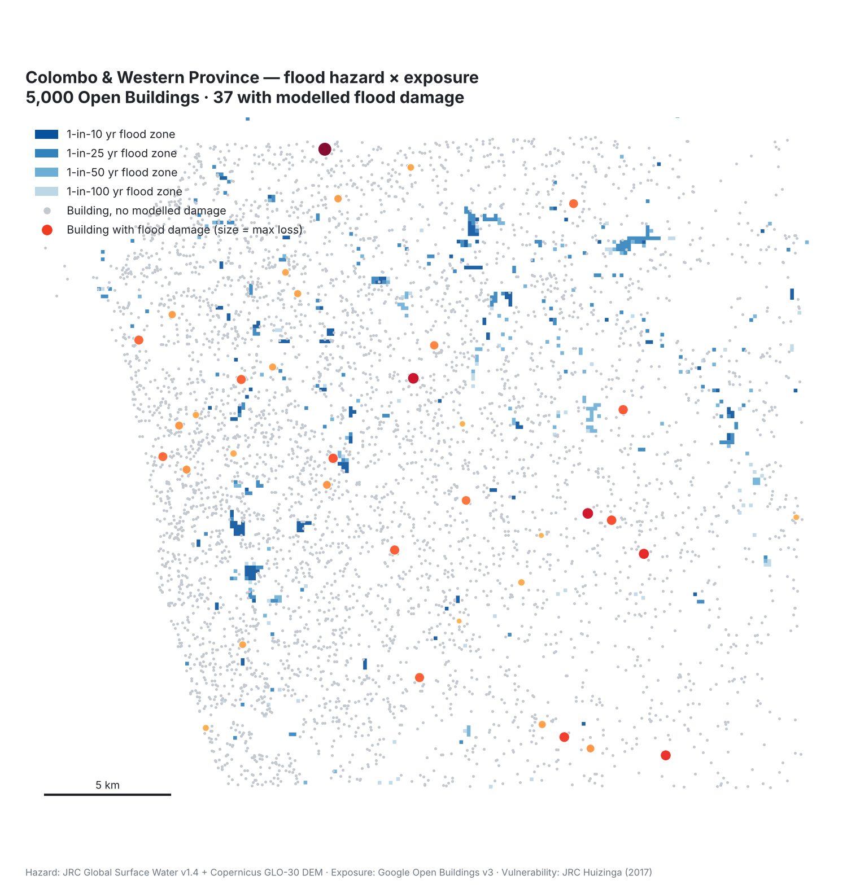
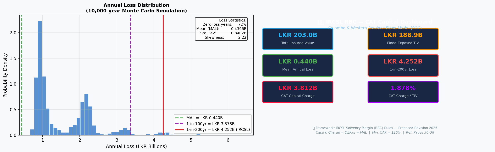
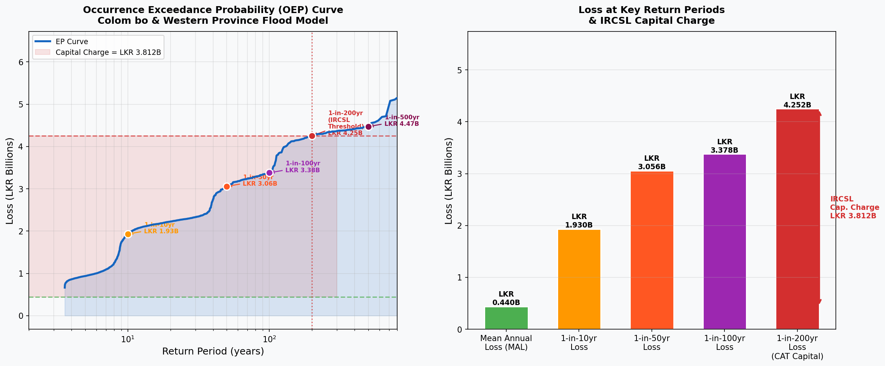
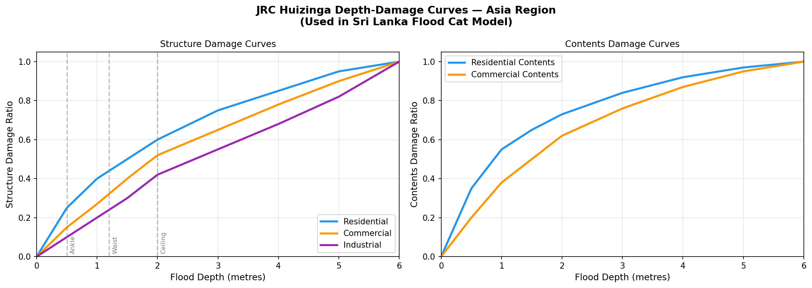

# Sri Lanka Flood Catastrophe Model — IRCSL RBC POC

A proof-of-concept flood catastrophe model for **Colombo & Western Province**. It estimates the **CAT risk capital charge** under the Insurance Regulatory Commission of Sri Lanka's (IRCSL) proposed Risk-Based Capital framework.

It is an end-to-end, open-data pipeline: Google Earth Engine hazard and exposure → JRC vulnerability curves → 10,000-year Monte Carlo simulation → exceedance-probability (EP) curve → regulatory capital.



## Results



| Metric | Value (LKR) |
|---|---|
| Total Insured Value | 203.0 B |
| Mean Annual Loss (MAL) | 0.440 B |
| 1-in-10 yr loss | 1.930 B |
| 1-in-50 yr loss | 3.056 B |
| 1-in-100 yr loss | 3.378 B |
| **1-in-200 yr loss (OEP 99.5%)** | **4.252 B** |
| **CAT Capital Charge** | **3.812 B** (1.88% of TIV) |

**Capital Charge = OEP₂₀₀ − MAL**, following the IRCSL *Review of Risk-Based Capital — Public Consultation* (23 July 2025, pp. 36–38).





An interactive version of the hazard/exposure map is in [`flood_hazard_exposure_map.html`](flood_hazard_exposure_map.html). Download it and open it in a browser.

## Model pipeline

| Phase | Script | What it does |
|---|---|---|
| 1 | `phase1_setup.py` | GEE init, AOI (`79.80, 6.75 → 80.25, 7.15`), constants |
| 2 | `phase2_hazard.py` | 10/25/50/100-yr flood zones from JRC Global Surface Water occurrence + Copernicus DEM elevation deficit |
| 3 | `phase3_exposure.py` | 5,000 Google Open Buildings (confidence ≥ 0.70), occupancy class, floors, structure + contents sum insured; point-in-polygon join to the flood zones |
| 4 | `phase4_vulnerability.py` | JRC Huizinga (2017) Asia depth-damage curves → damage ratio per building per return period |
| 5 | `phase5_loss_estimation.py` | 11-event catalog (Poisson, λ = 1/RP), 10,000-year Monte Carlo simulation of annual losses |
| 6 | `phase6_capital_charge.py` | OEP curve, return-period losses, IRCSL capital charge |
| 7 | `phase7_visualization.py` | Folium map + figures |

Everything is orchestrated in **`SriLanka_Flood_CatModel_IRCSL.ipynb`**.

## Data sources (all open)

| Layer | Dataset | Access |
|---|---|---|
| Hazard | JRC Global Surface Water v1.4 | GEE `JRC/GSW1_4/GlobalSurfaceWater` |
| Elevation | Copernicus GLO-30 DEM | GEE `COPERNICUS/DEM/GLO30` |
| Exposure | Google Open Buildings v3 | GEE `GOOGLE/Research/open-buildings/v3/polygons` |
| Vulnerability | Huizinga et al. 2017, *Global flood depth-damage functions* (EUR 28552 EN) | Published literature |
| Admin bounds | USDOS LSIB 2017 | GEE `USDOS/LSIB_SIMPLE/2017` |

## Setup

```bash
conda create -n catmodel python=3.11 -y
conda activate catmodel
conda install -c conda-forge geopandas folium scipy matplotlib branca jupyter -y
pip install earthengine-api geemap
earthengine authenticate
```

Set your GEE project ID in Phase 1 (`ee.Initialize(project='your-gee-project-id')`), then run **Kernel → Restart & Run All** in the notebook.

## Outputs

| File | Contents |
|---|---|
| `ep_curve.csv` | Full EP curve, for actuarial review |
| `annual_losses.npy` | 10,000 simulated annual losses |
| `capital_summary.json` | MAL, OEP at key return periods, capital charge |
| `buildings_df_with_dr.csv` | Exposure with depths and damage ratios per return period |
| `hazard_zones.geojson` / `hazard_zonal_stats.csv` | Flood-zone polygons and statistics |
| `SriLanka_FloodCatModel_POC_Report.pdf` | Written POC report |

## Limitations

- Flood depth comes from the DEM elevation deficit, not a hydraulic model such as HEC-RAS or LISFLOOD.
- Sum insured values are synthetic: the average property value is LKR 15 M and costs per m² vary by occupancy.
- The event catalog has only 11 events. A production model needs thousands.
- There is no storm-surge or coastal peril, and events are treated as independent (Poisson).
- The exposure is a sample of 5,000 buildings, not the full building stock.

## Path to production

Replace the hazard with GloFAS, LISFLOOD or HEC-RAS outputs; use a real insurer policy database as exposure; extend the event catalog with DMC historical flood records; add coastal flood (Kelani estuary, Negombo lagoon); calibrate the damage curves with post-event surveys; and have the Appointed Actuary review the model before submitting it to IRCSL.

---
*Author: [Anusha](https://github.com/anusha-0)*
